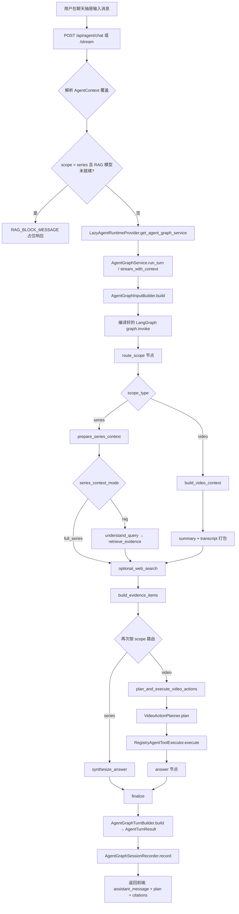
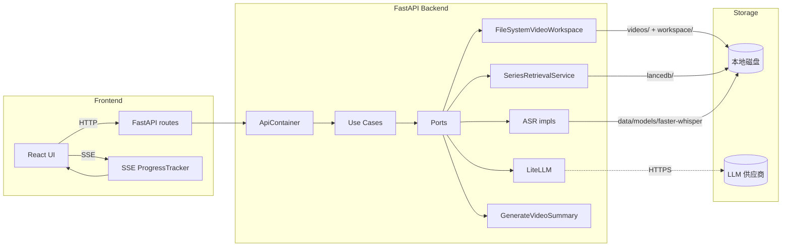
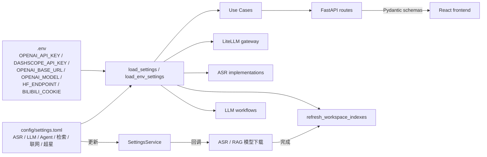

# vsummary 项目代码解析文档

> 版本：v0.3.9
> 项目定位：本地优先的视频 AI 总结 / 对话式知识库工具（FastAPI + React + LangGraph + LlamaIndex）

---

## 1. 项目概述

### 1.1 一句话定位
vsummary 是一个**本地优先的视频 AI 总结与对话式知识库工具**：把本地/B 站/超星导入的视频，转写为带章节的知识库，再围绕内容进行多轮对话与检索增强问答。

### 1.2 核心特性
- **视频 → 可检索知识库**：导入视频后自动生成转写、概况、章节、思维导图、知识卡片
- **系列管理**：课程/讲座等成组视频的统一工作区视角
- **单视频深度阅读**：每个视频有独立工作区（视频、概况、思维导图、知识卡、笔记）
- **章节跳转**：点击章节/转写段 → 自动 seek 到对应时间点并播放
- **MCP 自动化**：通过 Model Context Protocol 让外部 AI 助手创建/导入/处理视频系列
- **本地优先**：原始视频、转写、笔记、向量索引都落本地，只把 LLM 文本请求发给供应商
- **可分发**：提供 CPU/GPU 整合包，`start.bat` / `start.command` 一键启动

### 1.3 技术栈总览

| 层 | 技术 |
|---|---|
| 后端框架 | FastAPI 0.115 + uvicorn |
| Agent 工作流 | LangGraph（StateGraph） |
| RAG | LlamaIndex + LanceDB + FastEmbed（BGE 中文向量）+ BGE Reranker |
| LLM 抽象 | LiteLLM（统一 OpenAI 兼容 / DashScope / Ollama 等） |
| ASR | faster-whisper / whisper.cpp / 阿里云百炼 |
| 前端 | React 19 + Vite 7 + Tailwind + D3 + Markmap + Framer Motion |
| 状态管理 | 自研 Reducer（`workspaceReducer.js`）+ SSE 实时进度流 |
| 配置 | `config/settings.toml`（按域分组）+ `.env`（密钥与供应商） |
| 打包分发 | Conda env (`environment.yml` / `environment.cpu.yml`) + PyInstaller 整合包 |
| 测试 | pytest（backend） + vitest + Playwright（frontend） |

### 1.4 入口与启动

- **后端入口**：`src/backend/api/http/server.py` → `uvicorn.run("backend.api.http.app:app")`，默认 `127.0.0.1:8001`
- **后端应用构造**：`src/backend/api/http/app.py:create_app()` — `FastAPI(title="video_include api")`，挂载 6 个路由 + MCP HTTP 端点 + 前端静态资源
- **前端入口**：`src/frontend/src/main.jsx` → `App.jsx`（顶层 `WorkspacePage`）
- **一键启动**：根目录 `start.bat`（Windows）/ `start.command`（macOS）— 后端用 conda env 跑 `python -m backend.api.http.server`，前端 `npm run dev`（默认 4173 端口）

---

## 2. 目录树导航

> 以下为关键目录树，每个条目附一句话职责说明。标注 [入口] / [配置] / [核心] 的条目请重点关注。

```
vsummary/
├── README.md                      [配置] 项目说明与功能演示
├── VERSION                        版本号（v0.3.9）
├── LICENSE                        MIT 许可证
├── .env.example                   [配置] 供应商密钥、ASR、B 站 Cookie 示例
├── .python-version                Python 版本（3.11）
├── .importlinter                  [配置] 分层依赖约束（详见 §5.3）
├── environment.yml                [配置] GPU 版 conda 依赖
├── environment.cpu.yml            [配置] CPU 版 conda 依赖
├── requirements.txt               pip 依赖（与 conda 环境对齐）
├── requirements.gpu.txt / .cpu.txt
├── start.bat / start.command      [入口] 一键启动脚本（同时拉起后端 + 前端）
├── update.bat / updater/          自更新脚本与逻辑（拉新版本并热重启）
│
├── assets/                        logo、截图、GIF 演示资源
├── config/
│   └── settings.toml.example      [配置] 运行参数模板（ASR / LLM / Agent / 检索 / 联网搜索 / 超星）
│
├── docs/                          用户文档（安装、FAQ 等）
│   └── analysis/                  [本目录] 项目代码解析文档
├── scripts/
│   ├── agent_regression_utils.py  Agent 回归测试工具
│   ├── review_report_utils.py     PR review 报告生成
│   ├── build_release.ps1          [核心] 整合包构建脚本
│   └── package/                   整合包模板（CPU/GPU 设置、环境、启动脚本）
│
├── skills/                        Agent 技能描述（提示给 LLM 用）
├── tests/
│   ├── backend/                   [核心] pytest 套件（unit + integration）
│   └── frontend/                  [核心] vitest + Playwright 套件
│
├── tools/
│   ├── benchmark_mindmap_protocols.py    思维导图协议基准测试
│   └── release_packaging.py        [核心] 发布打包工具
│
├── diagnose_gpu.py                GPU/驱动诊断脚本（启动前自检）
│
└── src/
    ├── backend/                   [核心] 后端 Python 包
    │   ├── __init__.py
    │   ├── agent/                 Agent 基础设施（会话、内存、上下文预算、网关、校验、prompt）
    │   ├── agent_graph/           [核心] LangGraph 对话图（节点、查询理解、回答合成、证据、动作）
    │   ├── api/                   [核心] FastAPI 路由、DI 容器、HTTP 工厂、Schema
    │   ├── bilibili/              B 站外链解析与下载（yt-dlp）
    │   ├── chaoxing/              超星学习通课程导入
    │   ├── mcp/                   [核心] MCP 服务器与客户端（暴露给外部 AI 助手）
    │   ├── shared/                共享工具（filesystem、llm usage、observability、bilibili helper）
    │   └── video_summary/         [核心] 视频总结产品包（domain/generation/library/infrastructure/tools）
    │
    └── frontend/                  [核心] 前端 React 应用
        ├── index.html
        ├── package.json
        ├── vite.config.js
        ├── tailwind.config.js
        └── src/
            ├── main.jsx           [入口] React 启动入口
            ├── App.jsx            [入口] 顶层组件（hash 路由：`#test` 切到 MotionShowcase）
            ├── dev/               开发态展示组件
            ├── features/workspace/
            │   ├── model/         [核心] 状态机 reducer + 控制 hook + API 客户端
            │   └── ui/            [核心] 视图（Series/Studio/Overview/Mindmap/Notes/Chat 等）
            ├── lib/               动画工具
            ├── shared/lib/         时间格式化、焦点陷阱、外点检测 hook
            ├── styles.css          Tailwind 入口
            └── testing/           前端测试工具
```

### 2.1 后端关键模块导航（`src/backend/`）

| 路径 | 类型 | 职责 |
|---|---|---|
| `api/http/app.py` | [入口] | FastAPI 应用工厂；注册路由、挂载前端静态资源、MCP HTTP 端点 |
| `api/http/server.py` | [入口] | `python -m backend.api.http.server` 的 uvicorn 启动器 |
| `api/di/container.py` | [核心] | `ApiContainer` 依赖注入容器；通过 FastAPI `Depends` 注入到路由 |
| `api/di/bootstrap.py` | [核心] | `build_api_container(root_dir)`：装配所有用例、port 实现、进度跟踪器 |
| `api/routes/videos.py` | [核心] | 视频库 CRUD、总结/思维导图/知识卡/笔记、导入、生成触发、SSE 进度 |
| `api/routes/agent.py` | [核心] | `/api/agent/chat` 与 `/api/agent/chat/stream`（LangGraph 入口）|
| `api/routes/settings.py` | | 设置读写（ASR/LLM/检索/Agent 等）|
| `api/routes/health.py` | | 健康检查 |
| `api/routes/linked.py` | | B 站/超星外链导入与下载启动 |
| `api/routes/chaoxing.py` | | 超星单独路由 |
| `api/schemas/` | | Pydantic DTO 与 SSE 编码 |
| `api/adapters/agent_runtime_provider.py` | [核心] | Lazy 装配 `AgentGraphService`、`SeriesRetrievalService`、`MemoryMessageCompactor` |
| `api/workers/workspace_index_worker.py` | | 索引刷新工作器（嵌入完成时回调）|
| `agent_graph/runtime/graph.py` | [核心] | `build_agent_graph`：编译完整 LangGraph（route_scope → video/series 两条链路）|
| `agent_graph/runtime/nodes.py` | [核心] | 9 个节点工厂 + `finalize_state` |
| `agent_graph/runtime/service.py` | [核心] | `AgentGraphService`：对外 API（`run_turn` / `stream_with_context`）|
| `agent_graph/runtime/state.py` | [核心] | `AgentGraphState`：TypedDict 全局状态定义 |
| `agent_graph/runtime/streaming.py` | | SSE 流式编排（事件切分、延迟回答流）|
| `agent_graph/runtime/session_recorder.py` | | 会话持久化（`FileAgentSessionStore`）|
| `agent_graph/runtime/turns.py` | | 图输入与回合结果构建 |
| `agent_graph/query/` | | Series/Video 查询理解与回答合成（`SeriesQueryProcessor` / `AnswerSynthesisProgram`）|
| `agent_graph/actions/` | | 视频动作规划（`VideoActionPlanner`）与执行分发 |
| `agent_graph/evidence/` | | 引文、锚点、转写切片 |
| `agent_graph/prompts/` | | Action/Query 提示词 |
| `agent/` | | Agent 基础设施（context、memory、ports、schemas、session、validation、utils、infrastructure）|
| `video_summary/domain/models.py` | [核心] | 领域模型：`VideoAsset` / `Transcript` / `SummaryDocument` / `ManualTranscriptInput` |
| `video_summary/generation/usecases/generate_summary.py` | [核心] | 单视频总结编排（探测→抽音频→转写→增强→总结→落盘）|
| `video_summary/generation/usecases/generate_mindmap.py` | | 视频思维导图生成 |
| `video_summary/generation/usecases/generate_series_mindmap.py` | | 系列思维导图生成 |
| `video_summary/generation/ports.py` | | 端口定义（`MediaProcessor` / `Transcriber` / `Summarizer` 等）|
| `video_summary/generation/stage_cache.py` | | 生成阶段缓存（按 manifest 复用中间产物）|
| `video_summary/generation/cancellation.py` | | 取消信号上下文（与 SSE reporter 联动）|
| `video_summary/generation/renderers.py` | | Markdown ↔ 结构化 JSON 互转 |
| `video_summary/generation/schemas.py` | | 中间数据结构（`TranscriptSegmentPayload` 等）|
| `video_summary/library/` | [核心] | 库 DTO 模型、Markdown/字幕导出、链接模型、解析器、ports、用例（笔记/查询/导入/导出等）|
| `video_summary/library/usecases/summary_generation.py` | [核心] | 顶层用例 `GenerateVideoSummaryFromLibrary` / `GenerateSeriesSummaryFromLibrary` |
| `video_summary/library/usecases/imports.py` | | `ImportLocalSeries` / `ImportLocalPlaygroundVideos` / `ImportLocalSeriesVideos` |
| `video_summary/library/usecases/linked_videos.py` | | linked 系列相关用例（resolve/启动下载）|
| `video_summary/library/usecases/series_synopsis_generation.py` | | 系列目录 payload 构建（Agent 知识记忆用）|
| `video_summary/infrastructure/storage/filesystem_video_workspace.py` | [核心] | 以本地目录树为后端的 `VideoLibraryReader/Writer/Importer` 实现 |
| `video_summary/infrastructure/storage/library_generation_adapters.py` | | 把 use case 包成 workspace 适配器 |
| `video_summary/infrastructure/asr/` | | faster-whisper / whisper.cpp / 阿里云百炼 三种 ASR 实现 |
| `video_summary/infrastructure/llm/` | | LiteLLM 的总结/思维导图/知识卡/转写增强/联网搜索 实现 |
| `video_summary/infrastructure/rag/agent_memory/` | [核心] | LanceDB + FastEmbed + BGE Reranker 实现的 `SeriesRetrievalService` |
| `video_summary/infrastructure/rag/rag_models.py` | | 嵌入模型下载管理（`RagModelManager`）|
| `video_summary/infrastructure/config/settings.py` | | `settings.toml` 加载与默认值 |
| `video_summary/infrastructure/config/settings_service.py` | | 设置服务的端口实现 |
| `video_summary/infrastructure/mindmap_workflow.py` | | 视频思维导图 LLM 工作流 |
| `video_summary/infrastructure/series_mindmap_workflow.py` | | 系列思维导图 LLM 工作流 |
| `video_summary/infrastructure/video_summary_workflow.py` | | 视频总结 LLM 工作流 |
| `video_summary/infrastructure/media_tools.py` | | ffmpeg 媒体处理（抽音频、浏览器可播放 MP4 优化）|
| `video_summary/infrastructure/in_memory_progress_tracker.py` | | 内存进度跟踪器（生成/思维导图/下载/模型/超星/知识记忆）|
| `video_summary/infrastructure/subtitle_transcripts.py` | | SRT 解析 |
| `video_summary/tools/` | | Agent 工具实现（视频/系列/笔记/思维导图/概况/上下文访问）|
| `video_summary/tool_executor.py` | | 工具执行器注册表 |
| `video_summary/agent_adapter.py` | | `WorkspaceAgentContextLoader`：把 workspace DTO 转成 Agent 上下文 |
| `bilibili/ytdlp_bilibili.py` | | yt-dlp 封装 + Cookie 初始化 + 后台下载启动器 |
| `chaoxing/chaoxing_api.py` | | 超星 API 客户端与课程导入器 |
| `mcp/video_series_server.py` | [核心] | MCP 服务器工具集合（注册到 FastAPI `/mcp` 端点）|
| `mcp/video_series_client.py` | | MCP 客户端（HTTP 调用后端）|
| `shared/llm/` | | LiteLLM 网关、用量统计、base_url 规范化、JSON 模式、流式聊天 |
| `shared/observability.py` | | 日志 + 请求 ID 绑定 |
| `shared/filesystem.py` | | `KeyedLockManager` / `atomic_write_text` |
| `shared/bilibili_ytdlp.py` | | B 站 yt-dlp 共用 helper |

### 2.2 前端关键模块导航（`src/frontend/src/`）

| 路径 | 类型 | 职责 |
|---|---|---|
| `main.jsx` | [入口] | `ReactDOM.createRoot` + `<App/>` |
| `App.jsx` | [入口] | `useWorkspaceController` → `buildWorkspacePageModel` → `<WorkspacePage>` |
| `features/workspace/model/workspaceReducer.js` | [核心] | 单一 reducer 管理整个工作区状态 |
| `features/workspace/model/useWorkspaceController.js` | [核心] | 控制器 hook：装载 reducer + 副作用编排 |
| `features/workspace/model/useWorkspaceDataEffects.js` | | 数据副作用（拉取列表、订阅 SSE）|
| `features/workspace/model/workspaceState.js` | | 初始 state 工厂 |
| `features/workspace/model/workspaceApi.js` | | 与后端 API 的薄封装 |
| `features/workspace/model/workspaceChatState.js` | | 聊天子状态切片 |
| `features/workspace/model/workspaceChatActions.js` | | 聊天动作（发送/取消）|
| `features/workspace/model/workspaceChatRuntime.js` | | 聊天运行时（SSE 解析）|
| `features/workspace/model/workspaceContentActions.js` | | 笔记/总结/转写/卡片 CRUD 动作 |
| `features/workspace/model/workspaceSettingsActions.js` | | 设置更新动作 |
| `features/workspace/model/workspaceViewModel.js` | | 由 state 派生视图模型 |
| `features/workspace/model/workspaceTree.js` | | 库树形结构构造 |
| `features/workspace/ui/WorkspacePage.jsx` | [核心] | 顶层页面（库面板 + 中栏 + 右栏 + 工具栏 + 抽屉）|
| `features/workspace/ui/WorkspaceToolbar.jsx` | | 顶部工具栏（含 💬 聊天抽屉开关）|
| `features/workspace/ui/ChatDrawer.jsx` | | 右侧聊天抽屉（Esc 关闭）|
| `features/workspace/ui/WorkspaceChatPanel.jsx` | | 完整聊天面板（抽屉展开时使用）|
| `features/workspace/ui/WorkspaceVideoPlayer.jsx` | | 中栏视频/音频播放器（点击章节自动 seek）|
| `features/workspace/ui/WorkspaceLibraryPanel.jsx` | | 左栏库面板（系列/视频树）|
| `features/workspace/ui/WorkspaceReadingPane.jsx` | | 右栏阅读面板（按工具切换视图）|
| `features/workspace/ui/views/WorkspaceOverviewView.jsx` | | 视频 AI 概况（章节 + 转写展开）|
| `features/workspace/ui/views/WorkspaceMindmapView.jsx` | | 思维导图视图 |
| `features/workspace/ui/views/WorkspaceKnowledgeCardsView.jsx` | | 知识卡片视图 |
| `features/workspace/ui/views/WorkspaceNotesView.jsx` | | 笔记视图 |
| `features/workspace/ui/views/WorkspaceSeriesHomeView.jsx` | | 系列首页 |
| `features/workspace/ui/views/WorkspaceSeriesOverviewView.jsx` | | 系列概况视图 |
| `features/workspace/ui/views/WorkspaceSeriesMindmapView.jsx` | | 系列思维导图视图 |
| `features/workspace/ui/views/WorkspaceSeriesProgressView.jsx` | | 系列生成进度视图 |
| `features/workspace/ui/views/WorkspaceStudioHomeView.jsx` | | Playground 首页 |
| `features/workspace/ui/views/WorkspaceChatManagementView.jsx` | | 会话管理（清空/恢复）|
| `features/workspace/ui/views/WorkspaceContentEditorModal.jsx` | | 总结/转写 Markdown 编辑器弹窗 |
| `features/workspace/ui/WorkspaceImportModal.jsx` | | 本地媒体导入弹窗 |
| `features/workspace/ui/WorkspaceSettingsPanel.jsx` | | 设置面板（ASR/LLM/检索/联网/超星）|
| `features/workspace/ui/WorkspaceNativeSubtitleSettings.jsx` | | 原生字幕设置 |
| `features/workspace/ui/WorkspaceSubtitleDisplay.jsx` | | 视频字幕显示 |
| `features/workspace/ui/WorkspaceGenerationOverlay.jsx` | | 全屏生成遮罩（系列/视频）|
| `features/workspace/ui/MindmapCanvas.jsx` | | markmap 渲染画布 |
| `features/workspace/ui/workspaceLayout.js` | | 三栏布局计算 |
| `features/workspace/ui/workspacePageModel.js` | | state → page model 投影 |
| `features/workspace/ui/workspaceToolMeta.js` | | 工具元数据（图标、状态颜色）|

---

## 3. 主要业务逻辑解析

> 本节覆盖 4 条核心业务链路的完整流程图 + 文字说明：
> 1. **视频导入与生成总结**（单视频核心链路）
> 2. **Agent 对话（LangGraph）**（AI 助手核心链路）
> 3. **系列批量生成与知识记忆**
> 4. **B 站 / 超星外链导入与下载**

---

### 3.1 视频导入与生成总结（核心链路 A）

#### 流程图

```mermaid
flowchart TD
    A[用户选择本地媒体或拖入] --> B{选择目标}
    B -->|新建 Playground| C[POST /api/import/local/playground/from-paths]
    B -->|新建系列| D[POST /api/import/local/series/from-paths]
    B -->|追加到现有系列| E[POST /api/import/local/series/{id}/from-paths]

    C --> F[FileSystemVideoWorkspace.import_local_playground_videos_from_paths]
    D --> G[FileSystemVideoWorkspace.import_local_series_from_paths]
    E --> H[FileSystemVideoWorkspace.import_local_series_videos_from_paths]

    F --> I{videos/&lt;series&gt;/&lt;stem&gt;.&lt;ext&gt;}
    G --> I
    H --> I

    I --> J[FFmpeg: ensure_browser_playable_mp4]
    J --> K[POST /api/videos/{s}/{v}/generate]
    K --> L[GenerateVideoSummaryFromLibrary.run]
    L --> M[probe_duration]
    M --> N[extract_audio]
    N --> O[transcribe: faster-whisper / whisper.cpp / aliyun_bailian]
    O --> P{启用增强?}
    P -->|是| Q[LLM enhance_transcript]
    P -->|否| R[写入 transcript.cleaned.json]
    Q --> R
    R --> S[LLM summarize 生成 SummaryDocument]
    S --> T[写入 summary.json + summary.md + screenshots/]
    T --> U[SSE: completed]
    U --> V[前端刷新：概况/章节/知识卡可用]
```

#### 文字说明

**1. 导入层**（`src/backend/api/routes/videos.py` 中 `import_local_*`）
- 三个端点都委托给 `FileSystemVideoWorkspace.import_*_from_paths`（`src/backend/video_summary/infrastructure/storage/filesystem_video_workspace.py`）
- 存储模式支持 `copy` / `hardlink` / `external_reference` 三种；`hardlink` 跨设备会被拒绝
- 失败回滚：创建目录失败、媒体优化失败时都会删除已落盘的目录与文件

**2. FFmpeg 优化**（`_prepare_imported_media`，`filesystem_video_workspace.py`）
- 调用 `FfmpegMediaProcessor.ensure_browser_playable_mp4` 把 MP4 的 `moov` atom 移到头部，使浏览器可即时 seek
- 失败抛 `ValueError`，由导入层捕获后回滚

**3. 生成触发**（`src/backend/api/routes/videos.py:generate_video_summary`）
- 端点：`POST /api/videos/{series_id}/{video_id}/generate`
- 委托给 `container.generate_video_summary.run(...)`，即 `GenerateVideoSummaryFromLibrary` 用例
- 同时创建 `InMemoryProgressTracker` reporter，前端通过 `/api/videos/{s}/{v}/generate/progress` 订阅 SSE

**4. 生成层**（`src/backend/video_summary/generation/usecases/generate_summary.py`）
- 流水线（`GenerateVideoSummary.run`）：`probe → extract_audio → transcribe → enhance? → drop_transcript → summarize → commit`
- 全部中间产物落在 `output_dir/.cache`（`GenerationStageCache`）和 staging 目录
- **只有最后一步原子 move** 到 `output_dir`，失败不会污染已有制品
- 取消：外部 `GenerationCancellationContext` 与 SSE reporter 的 `is_cancel_requested` 联动
- 阶段进度：转写按 0.0-1.0 插值映射到 20%-75% 区间

**5. LLM 调用**
- `ConfiguredVideoSummaryWorkflow`（`video_summary/infrastructure/video_summary_workflow.py`）→ `LiteLLMSummarizer`
- 输出 `SummaryDocument`：`title` / `overview` / `chapters[]` / `key_takeaways[]` / `core_problem` / `transcription_status`
- 章节截图（可选）：在 `output_dir/screenshots/*.jpg`，由 `_attach_chapter_screenshot_urls` 拼出 `/api/videos/{s}/{v}/screenshots/{filename}` URL

**6. 写入制品**
- `summary.json` — 结构化总结（前端概况视图消费）
- `summary.md` — Markdown 形态（可被前端编辑器直接编辑回写）
- `transcript.cleaned.json` — 清洗后的转写 segments
- `transcript.enhanced.json` —（可选）LLM 增强后的转写
- `screenshots/` — 章节截图

**7. 错误分类与 HTTP 状态码**（`videos.py` 路由层）
- `AsrModelNotReadyError` → 409
- `GenerateCancelledError` → 409
- `GenerationScopeBusyError` → 409
- `ValueError` → 400
- `RuntimeError` → 503

---

### 3.2 Agent 对话（核心链路 B）

#### 流程图



#### 文字说明

**1. 入口**（`src/backend/api/routes/agent.py`）
- `/api/agent/chat`：非流式；返回完整 `AgentTurnResult`
- `/api/agent/chat/stream`：流式 SSE；事件类型 `answer_started` / `answer_delta` / `answer_completed` / `action_started` / `action_completed` / `citation` / `error`
- 都会先调用 `_resolve_rag_block_message`：若 `scope_type=series` 且 RAG 嵌入模型正在下载或未下载，直接返回占位响应，不进入图

**2. 运行时装配**（`src/backend/api/adapters/agent_runtime_provider.py`）
- `LazyAgentRuntimeProvider`：首次 `get_agent_graph_service()` 时一次性构建并缓存：
  - `LiteLLMChatGateway`（planner 复用给 video answer）
  - `MemoryMessageCompactor`（按 0.90 压缩比）
  - `SeriesRetrievalService`（Lazy + RagModel-aware：嵌入模型下载完成前不构建）
  - `VideoActionPlanner` + `RegistryAgentToolExecutor`（注册 `OPEN_NOTES` / `SAVE_NOTE` / `VIDEO_SEEK`）
  - `LiteLLMNativeWebSearchGateway`（可选）
- 配置变更时可调用 `invalidate_agent_graph_service()` 强制重建

**3. 图结构**（`src/backend/agent_graph/runtime/graph.py`）
- LangGraph `StateGraph(AgentGraphState)`，11 个节点 + 3 个条件边
- 入口：`START → route_scope`
- 条件边 1（`route_scope` → `series` / `video`）
- 条件边 2（`prepare_series_context` → `full_series` / `rag`）
- 条件边 3（`build_evidence_items` → `series` / `video`）
- 终点：`finalize → END`

**4. 关键节点**（`src/backend/agent_graph/runtime/nodes.py`）
- `route_scope`：依据 `state["scope_type"]` 决定走哪条链路
- `prepare_series_context`：按预算预检决定 `full_series`（全部上下文塞入）还是 `rag`（检索）
- `build_video_context`：把"视频总结 + 完整转写"或"总结 + 转写 RAG"打包为 `retrieval_results`
- `understand_query`：`SeriesQueryProcessor` 把用户问题解析为结构化检索请求
- `retrieve_evidence`：`SeriesRetrievalService.search` + `BGEReranker.rerank`（可选）
- `optional_web_search`：启用时调 LiteLLM 原生 web search 追加证据
- `build_evidence_items`：跨多源去重、构造 `evidence_items[]`（带引文锚点）
- `synthesize_answer`：`SeriesAnswerSynthesizer.run`（series 链路专用）
- `plan_and_execute_video_actions`：video 链路让 LLM 决定调用哪些工具并立即执行
- `answer`：`AnswerSynthesisProgram.run`（video 链路专用）
- `finalize`：归一化 `answer_payload` / `assistant_message`

**5. 流式回答**（`src/backend/agent_graph/runtime/streaming.py`）
- 三类流：`graph_stream` / `tool_stream` / `answer_stream`
- 延迟回答流：若 `answer_stream_gateway` 不为 None，则在工具完成后用单独的 LLM 流做"自然语言回答"分片
- 兜底：从图的 token 流中按文本切片还原 `answer_delta` 事件

**6. 会话持久化**（`src/backend/agent/session/`）
- `FileAgentSessionStore` 把每个 session 的消息列表写到 `data/agent_sessions/`
- 路由层 `/api/agent/session/recover` 与 `/session/clear` 暴露给前端

**7. 上下文预算**（`src/backend/agent/`）
- `AgentContextBudgetService`：按 `warning` / `compact` / `blocking` 三档阈值评估
- `MemoryMessageCompactor`：超出 `compact_threshold_ratio`（默认 0.8）时压缩历史

---

### 3.3 系列批量生成与知识记忆（核心链路 C）

#### 流程图

```mermaid
flowchart TD
    A[POST /api/series/{id}/generate] --> B[GenerateSeriesSummaryFromLibrary.run]
    B --> C{已有 active run?}
    C -->|是| D[DuplicateSeriesGenerationError → 409]
    C -->|否| E[枚举系列下未处理视频]
    E --> F[按 video_generation_concurrency 并发触发 GenerateVideoSummaryFromLibrary]
    F --> G[每视频 SSE: 进度 → 完成 → 下一个]
    G --> H[生成完成后 RefreshSeriesKnowledgeMemory]
    H --> I[AgentWorkspaceIndexBuilder.refresh]
    I --> J[逐视频 upsert 到 LanceDB 向量索引]
    J --> K[save_series_catalog: series_catalog.json]
    K --> L[前端 SSE 收到 completed → 刷新系列首页]
```

#### 文字说明

**1. 入口**（`src/backend/api/routes/videos.py:generate_series_summaries`）
- `POST /api/series/{series_id}/generate`
- 委托给 `container.generate_series_summaries.run(...)`
- 进度通过 `/api/series/{id}/generate/progress`（SSE）与 `/generate/status`（快照）暴露

**2. 并发编排**（`src/backend/video_summary/library/usecases/summary_generation.py`）
- `GenerateSeriesSummaryFromLibrary`：在 `series_active_runs` 字典里登记当前 `run_id`，重复触发即抛 `DuplicateSeriesGenerationError`
- 内部循环调用 `GenerateVideoSummaryFromLibrary`，全局并发数由 `settings.generation.video_generation_concurrency` 控制（默认 5）
- 返回结果含 `completed_videos` / `skipped_videos` / `cancelled_videos`

**3. 取消**（`/api/series/{id}/generate/cancel`）
- `requested_run_id` 防误取消：若请求中的 run_id 与当前活跃 run_id 不匹配，返回 `stale` 状态
- 同时取消所有进行中的单视频生成 + linked 视频下载

**4. 知识记忆刷新**（`src/backend/api/workers/workspace_index_worker.py` + `src/backend/video_summary/infrastructure/rag/agent_memory/index_builder.py`）
- 每个视频生成完成后，`series_memory_refresher` 入队
- `AgentWorkspaceIndexBuilder`：调 FastEmbed 把 `summary.json` + 转写 segments 嵌入写入 LanceDB
- 同时把 `series_catalog.json` 落盘，供 LangGraph `prepare_series_context` 直接读取
- 嵌入模型下载完成时 `RagModelManager` 会触发 `on_download_completed` 回调，立即 `index_refresher.refresh_all()`

**5. linked 系列**（B 站/超星）
- `linked_series.json` 元数据 + `videos/<bvid>.mp4` 下载副本
- linked 视频的"已下载 → 转写完成"过程与本地视频共用同一管线
- `_list_videos_for_linked_series` 在列表时合并本地副本与 linked 标记

---

### 3.4 B 站 / 超星外链导入与下载（核心链路 D）

#### 流程图

```mermaid
flowchart TD
    A[用户在 UI 粘贴 B 站 URL 或超星课程页] --> B{来源类型}
    B -->|B 站视频| C[POST /api/linked/bilibili: ResolveBilibiliVideo]
    B -->|B 站系列| D[POST /api/linked/bilibili/series: ResolveBilibiliSeries]
    B -->|超星课程| E[POST /api/chaoxing/import: ChaoxingCourseImporter]

    C --> F[YtDlpBilibiliResolver.resolve_video]
    D --> G[YtDlpBilibiliResolver.resolve_series]
    F --> H[DrissionBilibiliCookieInitializer: 必要时刷 Cookie]
    G --> H
    H --> I[WorkspaceBackedLinkedSeries.save_linked_series]
    I --> J[linked_series.json 落盘]

    E --> K[ChaoxingDownloaderClient.fetch_courses]
    K --> L[ChaoxingCourseImporter.build_series_from_courses]
    L --> I

    J --> M[POST /api/linked/{series_id}/start-download]
    M --> N[BackgroundBilibiliDownloadStarter 或 ChaoxingLinkedVideoDownloadStarter]
    N --> O[yt-dlp / chaoxing-downloader 异步下载到 videos/{series}/{bvid}.mp4]
    O --> P[InMemoryProgressTracker: video_download_progress]
    P --> Q{全部下载完成?}
    Q -->|否| R[SSE 推送进度，前端等待]
    Q -->|是| S[用户点击"生成"进入链路 A/C]
```

#### 文字说明

**1. B 站解析**（`src/backend/bilibili/ytdlp_bilibili.py`）
- `YtDlpBilibiliResolver`：封装 `yt-dlp` 的 `--dump-json`，提取 `bvid` / `title` / `page` / `duration` / `cover`
- 多 P 视频拆成多个 `LinkedVideo`，`video_id` 形如 `{bvid}_p{page}`
- `DrissionBilibiliCookieInitializer`：用 DrissionPage 在 headless 浏览器里登录 B 站刷一次 `buvid3/4/fp` 等反爬 cookie，避免 SESSDATA 单 cookie 被 WAF 412

**2. 超星导入**（`src/backend/chaoxing/chaoxing_api.py`）
- `ChaoxingDownloaderClient`：基于第三方 `chaoxing-downloader` 包；请求延迟由 `settings.external_import.chaoxing.request_delay_seconds` 控制
- `ChaoxingCourseImporter.build_series_from_courses`：把课程里的每个视频视为一个 linked 视频

**3. linked 元数据**
- 保存路径：`workspace/<series_id>/linked_series.json`
- `is_agent_managed=true` 标记由 MCP 创建的系列（前端会展示不同的徽章）

**4. 后台下载**（`BackgroundBilibiliDownloadStarter`）
- 用 `asyncio.create_task` 在后台跑 yt-dlp，避免阻塞 HTTP 响应
- 进度上报到 `video_download_progress_tracker`，前端 SSE 订阅

**5. 下载完成后**
- 视频文件落到 `videos/<series_id>/<bvid>.mp4` 或 `<bvid>_p<page>.mp4`
- linked 元数据中的 `video_id` 与本地文件名 stem 一致，列表时合并显示

---

## 4. 核心模块/组件说明

### 4.1 后端核心模块

#### 4.1.1 `ApiContainer` 依赖注入容器
**位置**：`src/backend/api/di/bootstrap.py:53`
**职责**：把 FastAPI 路由需要的 60+ 个用例与端口实现聚合为一个不可变 dataclass，作为 DI 根。
**关键设计**：
- `frozen=True` — 容器创建后不可变；配置变更通过 `invalidate_*` 函数重建子对象
- `Callable[[], AgentGraphService]` — 惰性装配：首次访问 `get_agent_graph_service()` 时构建并缓存 `AgentGraphService`，避免冷启动时阻塞
- `build_api_container(root_dir)` — 唯一构造点；测试时可以注入替身（`generator` / `mindmap_generator` / `knowledge_card_generator` / `*_model_manager`）

#### 4.1.2 `FileSystemVideoWorkspace`
**位置**：`src/backend/video_summary/infrastructure/storage/filesystem_video_workspace.py`
**职责**：整套视频库以本地目录树为后端的实现（`videos/` 存媒体、`workspace/` 存制品）。
**目录约定**：
```
videos/<series_id>/<video_stem>.<ext>          # 原始媒体（hardlink/copy/external_reference）
workspace/<series_id>/series_meta.json        # 本地系列元数据
workspace/<series_id>/linked_series.json      # linked 系列元数据
workspace/<series_id>/series_catalog.json     # Agent 知识记忆用
workspace/<series_id>/mindmap.json            # 系列思维导图
workspace/<series_id>/<video_id>/summary.json
workspace/<series_id>/<video_id>/summary.md
workspace/<series_id>/<video_id>/transcript.cleaned.json
workspace/<series_id>/<video_id>/transcript.enhanced.json
workspace/<series_id>/<video_id>/knowledge_cards.json
workspace/<series_id>/<video_id>/mindmap.json
workspace/<series_id>/<video_id>/notes.json
workspace/<series_id>/<video_id>/screenshots/*.jpg
```
**线程安全**：笔记 CRUD 通过 `KeyedLockManager` 按 `(series_id, video_id)` 串行化；其他写操作依赖上层用例的互斥。

#### 4.1.3 `GenerateVideoSummary`（生成用例）
**位置**：`src/backend/video_summary/generation/usecases/generate_summary.py`
**职责**：单视频从原始媒体到结构化总结的完整流水线编排。
**流水线**：`probe → extract_audio → transcribe → enhance? → drop_transcript → summarize → commit`
**持久化策略**：
- `output_dir` 是用户可见的制品目录
- `staging_dir` 是中间产物目录，失败时整体清理
- `output_dir/.cache` 是按 manifest 复用的中间产物缓存（音频/转写/增强结果）

**取消机制**：`GenerationCancellationContext` 与 SSE reporter 的 `is_cancel_requested` 联动；任何阶段触发取消都会中断后续 LLM 流与子进程。

#### 4.1.4 `AgentGraph`（LangGraph 对话图）
**位置**：`src/backend/agent_graph/runtime/graph.py:build_agent_graph`
**职责**：把整个 Agent 对话编排为一张 LangGraph 图，11 节点 + 3 条件边。
**双链路设计**：
- `series` 链路：跨视频检索（适合"这个系列讲了什么""对比不同视频"）
- `video` 链路：单视频深度阅读（适合"这个视频里 X 是怎么定义的"），允许调用工具打开笔记/seek 视频

**视频上下文预算**（`build_video_context` 节点）：
- 若"总结 + 完整转写"能塞进 `context_window - reserved_output` token，则走 `full_transcript` 模式
- 否则走 `summary_plus_transcript_rag` 模式（转写 RAG 检索 + 总结）

#### 4.1.5 `LazyAgentRuntimeProvider`
**位置**：`src/backend/api/adapters/agent_runtime_provider.py`
**职责**：把昂贵的 Agent 依赖（LLM 网关、RAG 检索、嵌入模型下载、思维导图工作流等）延迟装配。
**关键方法**：
- `get_agent_graph_service()`：首次调用构建并缓存 `AgentGraphService`
- `refresh_workspace_indexes()`：嵌入模型下载完成时回调用，全量刷新 LanceDB 索引
- `invalidate_agent_graph_service()` / `invalidate_workspace_indexes()`：配置变更或嵌入模型重建时强制重建
- `upsert_workspace_video(s, v)` / `delete_workspace_video(s, v)` / `delete_workspace_series(s)`：单视频级别索引维护

#### 4.1.6 `SeriesRetrievalService`（RAG 检索服务）
**位置**：`src/backend/video_summary/infrastructure/rag/agent_memory/retrieval.py`
**职责**：跨系列视频的 RAG 检索。
**关键组件**：
- LanceDB 持久化（`data/agent_graph/lancedb/`）
- FastEmbed 嵌入（`BAAI/bge-small-zh-v1.5`，CPU/GPU 可选）
- BGE Reranker（`BAAI/bge-reranker-base`，可选）

#### 4.1.7 `InMemoryProgressTracker`
**位置**：`src/backend/video_summary/infrastructure/in_memory_progress_tracker.py`
**职责**：生成/思维导图/下载/模型/超星/知识记忆 6 类长任务的进度跟踪器。
**对外接口**：
- `create_reporter(task_id)`：返回 `ProgressReporter`，支持 `update(stage, ratio, detail)` / `completed()` / `failed(reason)` / `cancelled()`
- `request_cancel(task_id)`：设置取消标志
- `get_snapshot(task_id)`：返回一次性快照
- SSE 端点使用 `stream_progress_events(tracker, task_id, terminal_statuses)` 持续推送

### 4.2 前端核心模块

#### 4.2.1 `workspaceReducer` 单一状态机
**位置**：`src/frontend/src/features/workspace/model/workspaceReducer.js`
**职责**：管理整个工作区的 UI 状态（库、选中视频、当前工具、聊天、生成进度等）。
**设计**：单一大 reducer + 按域分组的 action creators（`workspaceChatActions` / `workspaceContentActions` / `workspaceSettingsActions`）。

#### 4.2.2 `useWorkspaceController` 控制器
**位置**：`src/frontend/src/features/workspace/model/useWorkspaceController.js`
**职责**：把 reducer + 数据副作用（`useWorkspaceDataEffects`） + 动作派发聚合成一个 hook。
**关键职责**：
- 初始状态装载
- 拉取库列表 / 订阅 SSE
- 把路由切换（hash / 工具选择）翻译为 reducer action

#### 4.2.3 `WorkspacePage` 顶层页面
**位置**：`src/frontend/src/features/workspace/ui/WorkspacePage.jsx`
**职责**：三栏布局 + 顶部工具栏 + 抽屉。
**布局计算**：`workspaceLayout.js` 根据 `layout_mode`（`video_center` / `chat_center`）调整中栏与右栏宽度。
**抽屉**：`ChatDrawer.jsx`（点击工具栏 💬 滑出），按 `Esc` 或点击背景关闭，播放器继续播放不被打断。

#### 4.2.4 视图组件
- `WorkspaceOverviewView` — 视频 AI 概况（章节卡片 + 展开后的转写段；点击触发视频 seek）
- `WorkspaceMindmapView` / `WorkspaceSeriesMindmapView` — markmap 渲染的思维导图
- `WorkspaceKnowledgeCardsView` — 知识卡片
- `WorkspaceNotesView` — 笔记 CRUD
- `WorkspaceSeriesHomeView` / `WorkspaceSeriesOverviewView` — 系列首页与系列概况
- `WorkspaceStudioHomeView` — Playground 首页

---

## 5. 数据流向与关键依赖

### 5.1 端到端数据流总图



### 5.2 关键三方依赖清单

| 依赖 | 用途 | 关键代码位置 |
|---|---|---|
| `fastapi` + `uvicorn` | HTTP 服务 | `src/backend/api/http/app.py:create_app` |
| `langgraph` | Agent 工作流编排 | `src/backend/agent_graph/runtime/graph.py:build_agent_graph` |
| `lancedb` + `llama-index-vector-stores-lancedb` | 向量数据库 | `src/backend/video_summary/infrastructure/rag/agent_memory/retrieval.py` |
| `llama-index-core` + `llama-index-embeddings-openai` | RAG 抽象 | 同上 |
| `litellm==1.74.0` | LLM 统一网关 | `src/backend/shared/llm/litellm_gateway.py` + 多个 `litellm_*` 实现 |
| `faster-whisper` | 本地 ASR | `src/backend/video_summary/infrastructure/asr/faster_whisper_transcriber.py` |
| `whisper-cpp` (whisper-cli) | CPU ASR 备选 | `src/backend/video_summary/infrastructure/asr/whisper_cpp_transcriber.py` |
| `dashscope` | 阿里云百炼 ASR 与 LLM | `aliyun_bailian_transcriber.py` + `litellm` 通过 DashScope provider |
| `mcp` | Model Context Protocol | `src/backend/mcp/video_series_server.py` |
| `yt-dlp` | B 站视频下载 | `src/backend/bilibili/ytdlp_bilibili.py` |
| `chaoxing-downloader` | 超星课程下载 | `src/backend/chaoxing/chaoxing_api.py` |
| `srt` | SRT 解析 | `src/backend/video_summary/infrastructure/subtitle_transcripts.py` |
| `opencc-python-reimplemented` | 简繁转换 | `src/backend/video_summary/infrastructure/asr/faster_whisper_transcriber.py` |
| `huggingface-hub` | 模型下载（HF_ENDPOINT 支持镜像）| `src/backend/video_summary/infrastructure/asr/huggingface_model_downloader.py` |
| `httpx` | HTTP 客户端（MCP + 后端互调）| `src/backend/mcp/video_series_client.py` |
| `react` 19 + `vite` 7 | 前端框架与构建 | `src/frontend/package.json` |
| `markmap-view` + `markmap-toolbar` | 思维导图渲染 | `src/frontend/src/features/workspace/ui/MindmapCanvas.jsx` |
| `d3` | 数据可视化 | `WorkspaceSeriesProgressView.jsx` |
| `framer-motion` | UI 动画 | `WorkspacePage.jsx` + 抽屉 |
| `react-markdown` + `remark-gfm` + `remark-math` + `rehype-katex` + `katex` | Markdown 渲染（含公式）| `WorkspaceOverviewView.jsx` |
| `chart.js` + `react-chartjs-2` | 图表 | `WorkspaceUsagePage.jsx` |

### 5.3 分层约束（来自 `.importlinter`）

> vsummary 用 `import-linter` 严格约束后端包之间的依赖方向，保证可演进的 Clean Architecture。

| 契约 | 源模块 | 禁止依赖 |
|---|---|---|
| `backend top-level siblings must be acyclic` | `backend`（顶层） | 兄弟模块之间无环 |
| `agent_graph must not depend on video_summary infrastructure` | `backend.agent_graph` | `backend.video_summary.infrastructure` |
| `agent core must not depend on orchestration or product` | `backend.agent` | `backend.agent_graph`, `backend.video_summary` |
| `video_summary infrastructure must not depend on agent_graph` | `backend.video_summary.infrastructure` | `backend.agent_graph` |
| `domain must not depend on api or infrastructure` | `backend.video_summary.domain` | `backend.api`, `backend.video_summary.infrastructure` |
| `video_summary layers` | `backend.video_summary` | infrastructure → library → generation → domain 内层不可反向依赖外层 |
| `generation must not depend on library` | `backend.video_summary.generation` | `backend.video_summary.library` |
| `video_summary tools must not depend on infrastructure` | `backend.video_summary.tools` | `backend.video_summary.infrastructure` |
| `tool executor and agent adapter are the only bridges` | 其余 video_summary 子包 | `backend.agent`（仅 `tool_executor.py` 与 `agent_adapter.py` 可越界）|
| `bilibili must not depend on video_summary infrastructure directly` | `backend.bilibili` | `backend.video_summary.infrastructure` |

### 5.4 配置与运行时数据流



**关键说明**：
- `load_env_settings`：读取 `.env` 里的 `OPENAI_API_KEY` / `OPENAI_BASE_URL` / `OPENAI_MODEL` / `OPENAI_PROVIDER`，喂给 LiteLLM
- `load_settings`：读取 `config/settings.toml`，按域解析为 dataclass（`AsrSettings` / `AgentContextSettings` / `AgentRetrievalSettings` / `GenerationSettings` / `WebSearchSettings` / `ExternalImportSettings` / `WorkspaceUiSettings` / `DebugSettings`）
- `SettingsService`：把设置写回磁盘时同时触发模型管理器刷新（`faster_whisper_model_manager` / `whisper_cpp_model_manager` / `rag_model_manager`）

### 5.5 测试覆盖概览

**后端**（pytest）：
- `tests/backend/unit/`：单元测试，按模块拆分（`asr`、`agent`、`agent_memory`、`api`、`bilibili`、`chaoxing`、`generation`、`infrastructure`、`library`、`llm`、`mcp`、`mindmap`、`models`、`packaging`、`settings`、`shared`、`updater`、`workspace`）
- `tests/backend/integration/`：集成测试（`agent`、`api`、`bilibili`、`llm`、`packaging`）
- `tests/fixtures/`：固定数据（如 `series_scope/`）

**前端**：
- `tests/frontend/features/workspace/`：vitest（model + ui）
- `src/frontend/playwright.config.js`：E2E（`test:e2e`）

---

## 6. 附录：常用操作与入口速查

| 想做的事 | 看哪个文件 |
|---|---|
| 添加一个新的视频相关 API 端点 | `src/backend/api/routes/videos.py` + `bootstrap.py` 中注册用例 |
| 添加一个新的 Agent 工具 | `src/backend/video_summary/tools/` + `src/backend/agent/schemas/tool_calls.py` 注册 `ToolName` |
| 修改 LangGraph 图结构 | `src/backend/agent_graph/runtime/graph.py` + `runtime/nodes.py` |
| 修改 LLM 调用方式 | `src/backend/shared/llm/litellm_gateway.py` + 各 `litellm_*_generator.py` |
| 修改 ASR 引擎 | `src/backend/video_summary/infrastructure/asr/` + `config/settings.toml.example` |
| 修改前端 UI 布局 | `src/frontend/src/features/workspace/ui/WorkspacePage.jsx` + `workspaceLayout.js` |
| 修改生成流水线 | `src/backend/video_summary/generation/usecases/generate_summary.py` |
| 调整依赖分层 | `.importlinter` |
| 调整启动方式 | `start.bat` / `start.command` / `src/backend/api/http/server.py` |
| 打包整合包 | `scripts/build_release.ps1` + `tools/release_packaging.py` + `scripts/package/` |

---

## 7. [待确认] 与开放问题

> 以下内容基于代码阅读无法 100% 确认，建议在评审前与项目维护者对齐：

1. **[待确认]** `src/backend/video_summary/infrastructure/runtime.py` 与 `video_summary_runtime.py` 的职责分工 — 表面看两者都涉及"运行时构建"，需要确认哪个是给 `bootstrap` 用的主路径
2. **[待确认]** `SeriesRetrievalService` 在嵌入模型未下载时，`upsert_video` 的行为是"静默跳过"还是"抛错后由上层兜底" — 需结合 `LazyAgentRuntimeProvider` 的 `_RagModelAwareRetrievalService` 包装来确认
3. **[待确认]** 前端 SSE 断线重连策略 — `WorkspaceGenerationOverlay` 是否实现了指数退避重连
4. **[待确认]** LangGraph `defer_answer_stream` 字段的边界条件 — 仅在 `answer_stream_gateway` 不为 None 且 `use_answerer=True` 时启用，建议读 `agent_graph/runtime/streaming.py` 完整 200+ 行后再确认
5. **[待确认]** `agent_graph/runtime/nodes.py` 中 `prepare_series_context` 的 `full_series` vs `rag` 决策阈值（默认 token 数）— 是否对应 `direct_summary_threshold_ratio`
6. **[待确认]** `update.bat` / `updater/` 的精确自更新语义（是否包含数据库迁移、嵌入模型兼容性处理）
7. **[待确认]** `WorkspaceUsagePage` 对应的"用量统计"数据源是 `SQLiteLlmUsageStore`（`shared/llm/usage.py`）还是另有其他来源
8. **[待确认]** `tests/backend/integration/packaging/` 的覆盖范围 — 是否包含整合包真实下载与启动测试

---

*本文档基于 v0.3.9 源码直接生成，未引用任何外部未公开资料。流程图节点对应代码路径均标注行号（如有变动请以最新代码为准）。*
